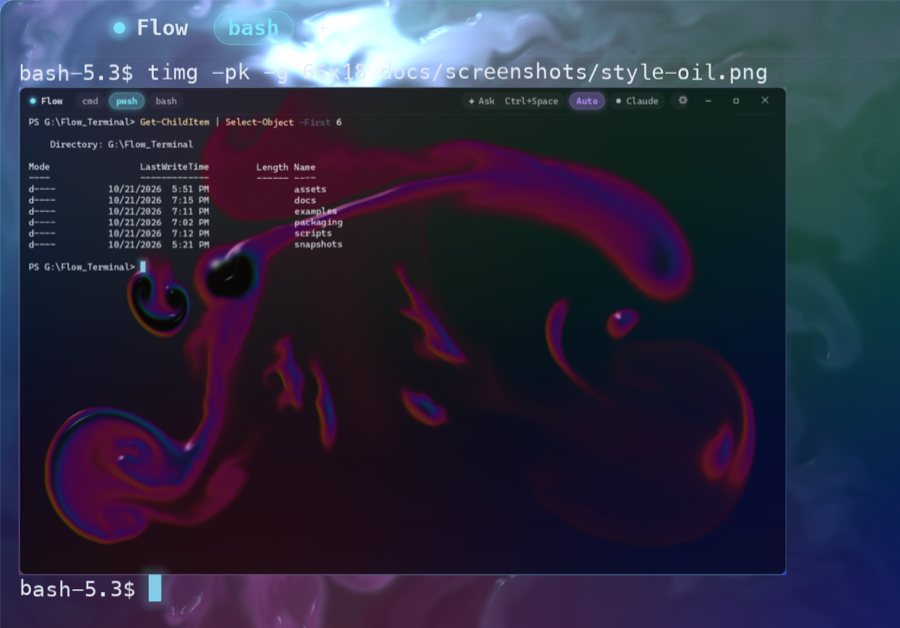
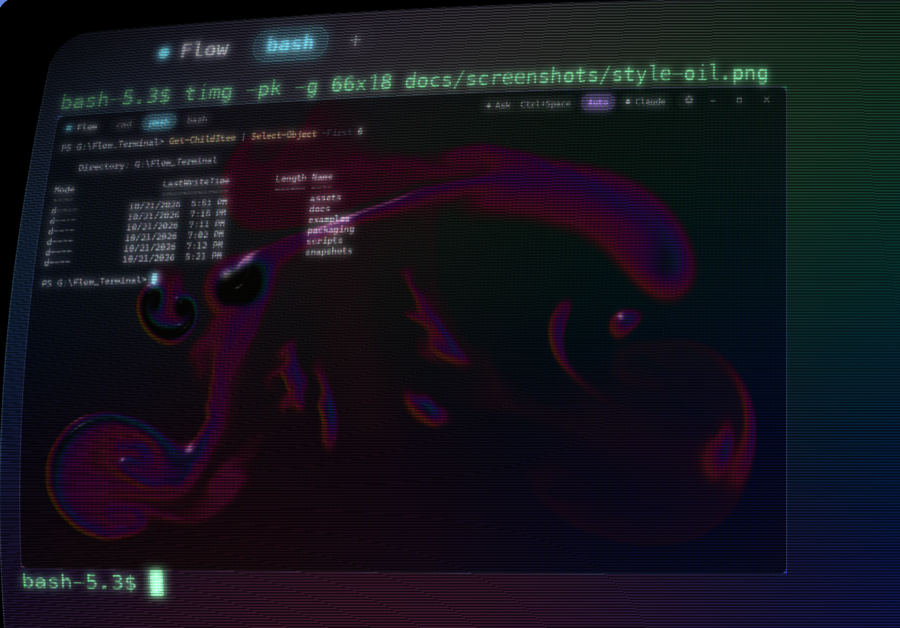
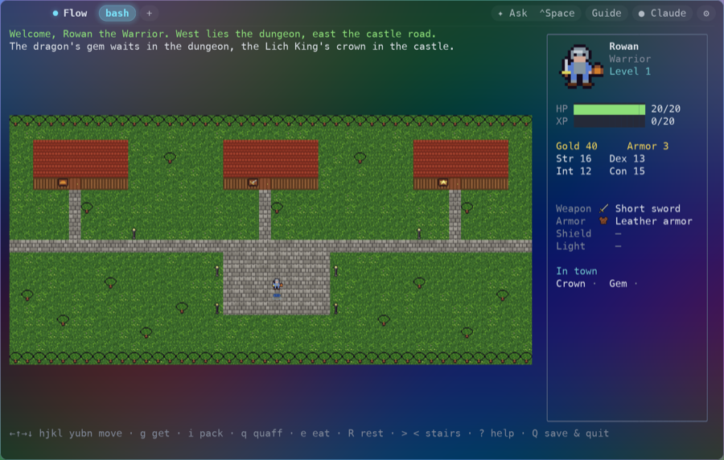
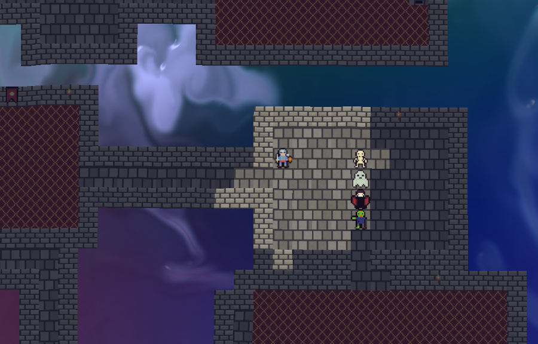
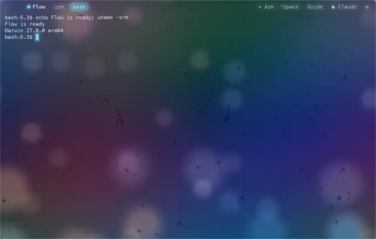
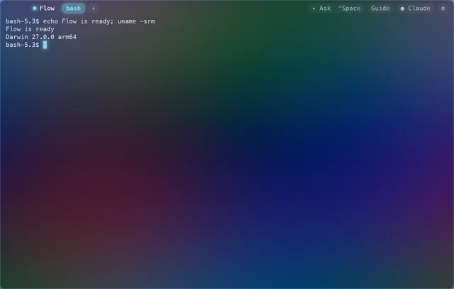
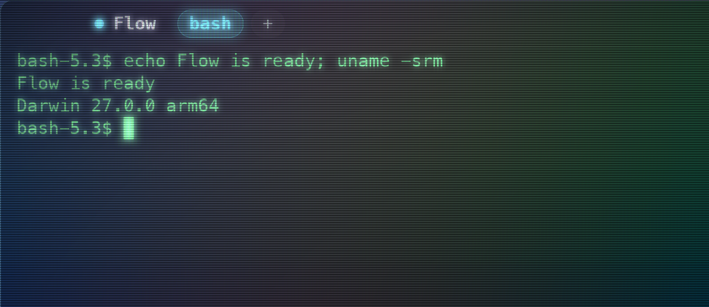

  

<h1 align="center">Flow</h1>

  A terminal for Windows and macOS with a liquid-glass look and an AI assistant built in. 
  <a href="https://github.com/arcanii/Flow-releases/releases/latest"><b>Download for Windows</b></a> ·
  <a href="https://github.com/arcanii/Flow-releases/releases/tag/v0.1.18-macos"><b>Download for macOS</b></a>

Type commands as usual, or describe what you want in plain English. The
assistant suggests the steps or runs them in your shell, and asks first before
anything risky. It's Anthropic's Claude, OpenAI's GPT or Google's Gemini,
whichever you prefer.

Flow runs the shells you already have. On Windows that's cmd, PowerShell and
bash; if you don't have Git Bash, MSYS2 or WSL, Flow brings its own bash:
BusyBox, a small POSIX shell with the usual Unix tools. On the Mac it's zsh and
bash, with a menu bar, a right-click menu and the keys you're used to from
Terminal.

Programs can show pictures in it, too. Flow speaks the [kitty graphics
protocol](#images), so image tools such as `viu` and `timg` draw right in the
terminal, and the pictures ride the liquid and glow under the CRT like the text
around them.

## Tabs

One window holds as many terminals as you like, each in a tab running the shell
you pick. **⌘T** (**Ctrl+Shift+T** on Windows) opens a tab with your default
shell, in the folder of the tab in front, and the **+** after the tabs opens one
with any other shell. **⌘W** (**Ctrl+Shift+W**) closes a tab, **⌘1** to **⌘9**
(**Ctrl+Shift+1** to **9**) jump to one, and **⇧⌘]** and **⇧⌘[** (**Ctrl+Tab**
and **Ctrl+Shift+Tab**) step through them. The assistant works in the tab in
front.

Tabs came to the Mac in Flow 0.1.7 and to Windows in 0.1.8.

## Images

<table>
  <tr>
    <td></td>
    <td></td>
  </tr>
  <tr>
    <td>A picture from <code>timg</code>, over the <b>Clouds</b> style</td>
    <td>The same picture under the <b>CRT</b>: scanlines, curve and glow</td>
  </tr>
</table>

Programs can show pictures in the terminal through the [kitty graphics
protocol](https://sw.kovidgoyal.net/kitty/graphics-protocol/), the one most
image tools speak today. `viu` finds it by itself; `timg` needs `-pk` for now,
since it doesn't know Flow by name yet. Other tools that speak it, such as
`kitten icat`, yazi, ranger and Neovim's image plugins, should work too.

A picture sits in the terminal like text: it scrolls with it, goes into the
scrollback and clears with `clear`. It rides the liquid as text does, and under
the CRT it gets the scanlines, the curve and the phosphor's glow. Copying text
leaves pictures out.

Images came to the Mac in Flow 0.1.17. Windows doesn't have them yet: the
console layer Windows puts between Flow and the shell (ConPTY) drops the
protocol's escapes.

## Flow Rogue

<table>
  <tr>
    <td></td>
    <td></td>
  </tr>
  <tr>
    <td>The town: three shops, the well, and the roads west to the dungeon and east to the castle</td>
    <td>In the castle, over the <b>Clouds</b> style. The ghost is see-through.</td>
  </tr>
</table>

Flow comes with a game. Type `flow-rogue` in a Flow tab: a roguelike in the
spirit of Rogue, drawn in animated sprites. Make a warrior, mage or rogue,
outfit them at the town's shops, and go down the dungeon after the red dragon's
gem or up the castle after the Lich King's crown. Each has five floors, new on
every visit. Come back to town to heal at the well and buy better gear, and
bring both treasures home to win.

The sprites are pictures like those above, so the game takes on the liquid
style, glow and CRT you've chosen. `?` lists the keys, and `Q` saves the
adventure for next time.

Flow Rogue came to the Mac in Flow 0.1.18. Windows doesn't have it yet.

## Liquid glass

The glass is a live fluid simulation, and your cursor and typing stir it up.
Pick a style in Settings, and slow it down if you like:

<table>
  <tr>
    <td></td>
    <td></td>
  </tr>
  <tr>
    <td><b>Clouds</b>, with optional lightning</td>
    <td><b>Water from above</b>: ripples, sunlight and caustics</td>
  </tr>
  <tr>
    <td></td>
    <td></td>
  </tr>
  <tr>
    <td><b>Water from below</b>: light shafts and bubbles</td>
    <td><b>Oil</b>: a glossy, thin-film sheen</td>
  </tr>
  <tr>
    <td></td>
    <td></td>
  </tr>
  <tr>
    <td><b>Rain</b> on a fogged window: drops run down and grow, and your cursor wipes the glass</td>
    <td><b>None</b>: plain tinted glass with nothing moving behind it</td>
  </tr>
</table>

In Settings you can also pick the terminal's font from the monospaced fonts on
your computer. Since 0.1.8, **Text color** and **Cursor color**
offer a row of swatches (any other color works as `#RRGGBB` in the config
file), and **Glow** turns the glow around the cursor, tabs and buttons down to
nothing or up to 200%.

Since 0.1.9, each color also shows as its `#RRGGBB` value, which opens a color
picker: drag for saturation and brightness, pick the hue on a bar, or type or
paste a hex value. A third color, **Background**, tints the glass behind the
terminal under any liquid style.

## The glass reacts

Whatever the style, the glass also shows what your terminal is up to:

- **Commands:** when one finishes, a ring spreads from the prompt (red if it
  failed, wider after a long run), and the liquid splashes in its own way, with
  bursts of cloud, ripples, bubbles or running drops.
- **Progress:** programs that report how far along they are, such as Cargo,
  fill the glass from the bottom like a tank.
- **The assistant:** while it thinks, the liquid leans toward its panel. Each
  step it takes splashes, and a finished task blooms.
- **Tabs:** when a long command finishes in a tab you aren't looking at, that
  tab glows green, or red if the command failed.

Prefer a calm window? Turn off **Reactions** in Settings. The reactions came to
the Mac in Flow 0.1.7 and to Windows in 0.1.8.

## CRT

The **CRT** section of Settings shows everything, over any liquid style, as an
old tube monitor would. **Preset** picks a ready-made look (Subtle, Classic,
Arcade, Phosphor or Television), **Strength** sets how strongly it shows, and
each part has a row of its own:

- **Scanlines:** how dark every other line is
- **Interlace:** the lit and dim lines swap each frame
- **Phosphor glow:** the light bright text spreads over the lines
- **Phosphor decay:** how long the afterglow lingers when text changes or
  scrolls, up to 300 ms
- **Grille:** the fine stripes of red, green and blue phosphor
- **Vignette:** darker toward the corners
- **Curvature:** the picture bulges like a tube's glass, inside a black bezel.
  Clicks, selections and the pointer follow the curve.

**Your presets → Save as…** keeps the look under a name you choose, to pick
again from **Preset**. The CRT looks best with the **None** style and Green or
Amber text. With Interlace or Phosphor decay on, Flow draws every frame while
it's in front, which uses more power.

Since Flow 0.1.12, on the Mac and Windows, the CRT needs about half the memory
it did: full screen on a 3456 × 2234 display, about 97 MB instead of 185 MB. With
**Phosphor decay** at 0 it keeps no afterglow at all and needs about 35 MB.

The CRT came to the Mac in Flow 0.1.10, with its parts, curvature and presets
in 0.1.11. It came to Windows, all of it at once, in 0.1.11.

## Languages

Flow speaks English and Japanese: its menus, Settings, the assistant panel,
dialogs and messages. Pick one under **Settings → General → Language**, or
leave it on **Automatic** to follow your Mac's or Windows' language. The
assistant is told the language too, so it answers, and explains the commands
it suggests, in it. On a Mac set to Japanese, the update windows and the
permission prompts for programs run in Flow are in Japanese as well.

Flowは日本語に対応しています。設定の「一般」→「言語」で選ぶか、「自動」のままにするとMacやWindowsの言語に従います。

Japanese came to the Mac in Flow 0.1.10 and to Windows in 0.1.11. Since
0.1.12, **Automatic** follows the Windows display language too.

Since Flow 0.1.14 on the Mac and 0.1.15 on Windows, you can also type
Japanese (or Chinese or Korean) through the system's input method: at the
prompt, in the assistant's input and in a CRT preset's name. What you're
composing shows underlined where it will go, more heavily under the part being
converted, with the candidates beside it. Only what you commit reaches the
shell, so the Enter that confirms a conversion doesn't run the line. Settings
and the API key dialog take keys as they are, so the input method is off
there. On the Mac, a held letter still repeats instead of opening the accent
picker, and if **⌃Space** switches input sources, macOS takes it before Flow
sees it, so open the assistant with **Ask** in the title bar.

Flow 0.1.14（Mac）と0.1.15（Windows）からは、日本語入力でプロンプトやアシスタントの入力欄に日本語を入力できます。

## Screen refresh

**Settings → General → Screen refresh** sets how often Flow draws while
something moves or output comes in. **Display**, the default, keeps to your
screen's own rate: 60 Hz on most screens, 120 Hz on a ProMotion Mac. **30** to
**240 Hz** cap it, and a lower rate saves power. **Unlimited** doesn't wait for
the screen: each frame shows as soon as it's drawn, so text appears a little
sooner, but while anything moves Flow draws as often as it can, which uses the
most power. Behind other windows, Flow draws at most 20 frames a second
whatever it's set to.

Screen refresh came to the Mac and Windows in Flow 0.1.12.

## Download

### Windows

Get **Flow-&lt;version&gt;-setup.exe** from the
[latest release](https://github.com/arcanii/Flow-releases/releases/latest) and run it.

- The installer isn't code-signed yet, so SmartScreen may say "Windows
  protected your PC". Choose **More info → Run anyway**.
- Installed copies update themselves. Flow asks once whether to check
  automatically, and **About → Check for Updates…** checks on demand.
- Prefer not to install? Use the portable zip. Portable copies don't update
  themselves.
- `SHA256SUMS.txt` in each release lists the files' checksums.

### macOS

Get **Flow-&lt;version&gt;-macos.dmg** from the
[macOS release](https://github.com/arcanii/Flow-releases/releases/tag/v0.1.18-macos),
open it, and drag Flow to Applications. It runs on Macs with Apple silicon and
macOS 11 or later.

- Flow for macOS is signed and notarized, so it opens without a warning.
- It updates itself. Flow asks once whether to check automatically, and
  **Flow → Check for Updates…** checks on demand.
- `SHA256SUMS-macos.txt` in each macOS release lists the checksum.

## The assistant

The assistant needs an API key from its provider. Flow works as a terminal
without one and never asks for it on its own. Open Settings (`Ctrl+,`, or `⌘,`
on the Mac), pick the **Provider** under Assistant (Claude, GPT or Gemini), and
add that provider's key under **API key**. Each provider keeps its own key, in
Windows Credential Manager or the macOS Keychain. GPT and Gemini are new in
Flow, so expect some rough edges.

## More screenshots

<table>
  <tr>
    <td></td>
    <td></td>
  </tr>
  <tr>
    <td>Settings: the look, the font, the assistant and its provider, a token cap</td>
    <td>About, with a check for updates</td>
  </tr>
</table>

## What this repo holds

- The [releases](https://github.com/arcanii/Flow-releases/releases): the Windows
  installers, and the macOS disk images in the releases tagged `-macos`. Since
  0.1.1, each Windows release also carries the source of the BusyBox it
  bundles, which is free software under the GPL, version 2.
- `appcast.xml` and `appcast-macos.xml`, the update feeds that installed copies
  of Flow read on Windows and on macOS. Every update in them carries an EdDSA
  signature, and Flow refuses updates that don't verify.

Flow's source code isn't public yet, but I do plan to make it OpenSource when more mature.
This is also testing a release repo.
