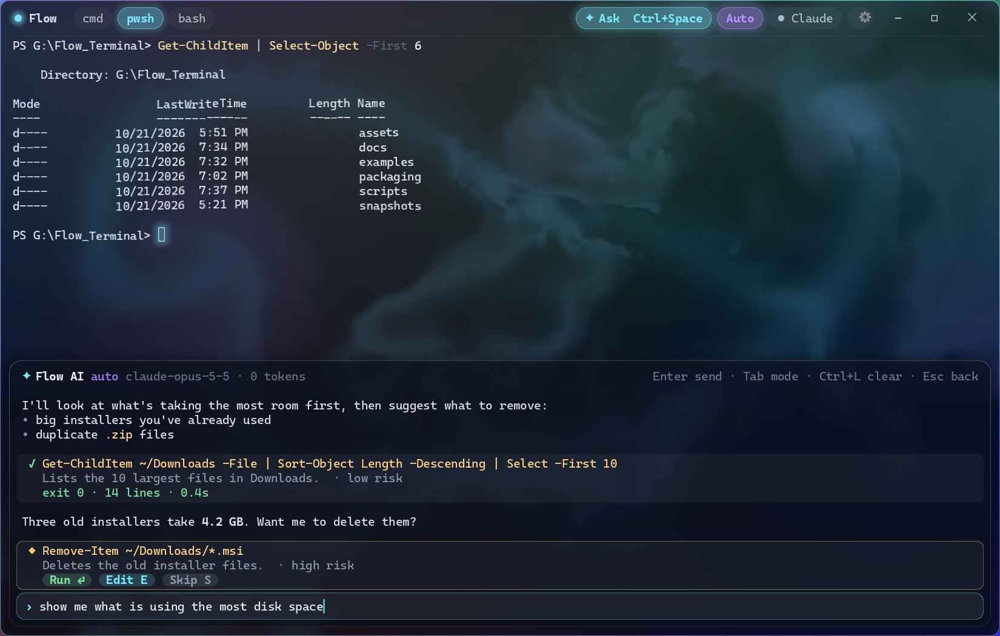
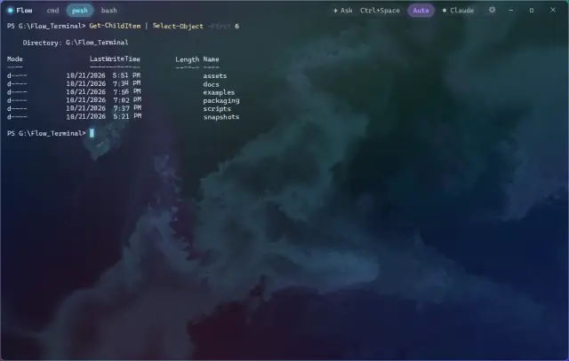
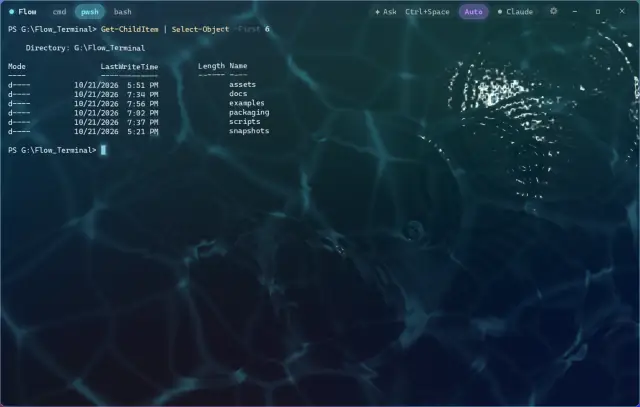
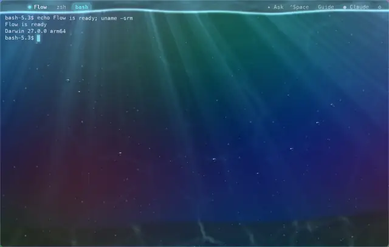
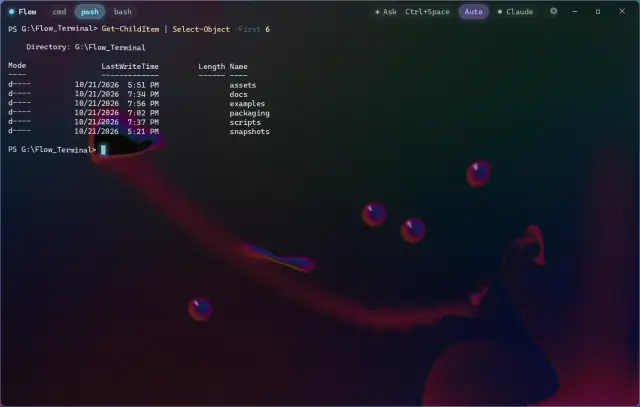
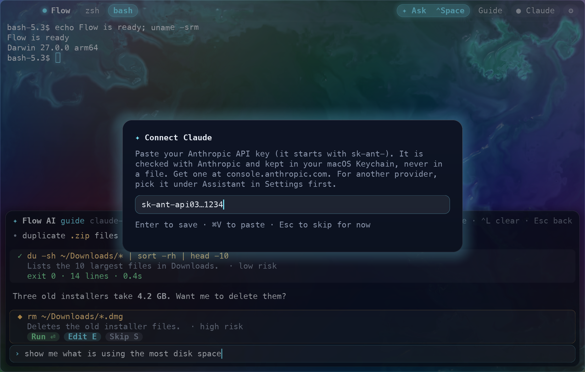
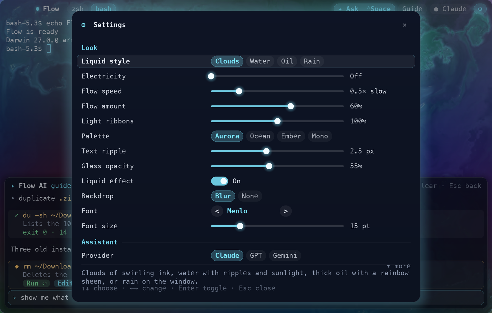
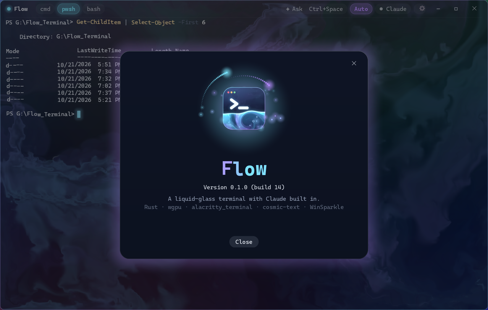

  

<h1 align="center">Flow</h1>

  A terminal for Windows with a liquid-glass look and Claude built in. 
  <a href="https://github.com/arcanii/Flow-releases/releases/latest"><b>Download the latest release</b></a>

Type commands as usual, or describe what you want in plain English. The
assistant suggests the steps or runs them in your shell, and asks first before
anything risky.

## Liquid glass

The glass is a live fluid simulation, and your cursor and typing stir it up.
Pick a style in Settings, and slow it down if you like:

<table>
  <tr>
    <td></td>
    <td></td>
  </tr>
  <tr>
    <td><b>Clouds</b>, with optional lightning</td>
    <td><b>Water from above</b>: ripples, sunlight and caustics</td>
  </tr>
  <tr>
    <td></td>
    <td></td>
  </tr>
  <tr>
    <td><b>Water from below</b>: light shafts and bubbles</td>
    <td><b>Oil</b>: a glossy, thin-film sheen</td>
  </tr>
</table>

## Download

Get **Flow-&lt;version&gt;-setup.exe** from the
[latest release](https://github.com/arcanii/Flow-releases/releases/latest) and run it.

- The installer isn't code-signed yet, so SmartScreen may say "Windows
  protected your PC". Choose **More info → Run anyway**.
- Installed copies update themselves. Flow asks once whether to check
  automatically, and **About → Check for Updates…** checks on demand.
- Prefer not to install? Use the portable zip. Portable copies don't update
  themselves.
- `SHA256SUMS.txt` in each release lists the files' checksums.

The assistant needs an Anthropic API key. Flow asks for it on first start and
keeps it in Windows Credential Manager.

## More screenshots

<table>
  <tr>
    <td></td>
    <td></td>
  </tr>
  <tr>
    <td>Settings: the look, the assistant, a token cap</td>
    <td>About, with a check for updates</td>
  </tr>
</table>

## What this repo holds

- The [releases](https://github.com/arcanii/Flow-releases/releases) with the
  installers.
- `appcast.xml`, the update feed that installed copies of Flow read. Every
  update in it carries an EdDSA signature, and Flow refuses updates that don't
  verify.

Flow's source code isn't public yet, but I do plan to make it OpenSource when more mature.
This is also testing a release repo.
