<p align="center">
  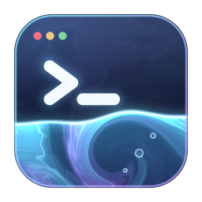
</p>

<h1 align="center">Flow</h1>

<p align="center"><i>A terminal for macOS, Windows and Linux with a liquid-glass look, old machines' themes, pictures and 3D in the terminal, and an AI assistant built in.</i></p>

<p align="center">
  <a href="#macos"></a>
  <a href="#windows"></a>
  <a href="#linux"></a>
  <a href="https://github.com/arcanii/Flow-releases/releases"></a>
</p>

<p align="center">
  
  
  
  
  
  
</p>

<p align="center">
  <a href="https://github.com/arcanii/Flow-releases/releases/tag/v0.1.39-macos"><b>Download for macOS</b></a> ·
  <a href="https://github.com/arcanii/Flow-releases/releases/latest"><b>Download for Windows</b></a> ·
  <a href="https://github.com/arcanii/Flow-releases/releases/tag/v0.1.39-linux"><b>Download for Linux</b></a>
</p>

---

Type commands as usual, or tell the assistant in plain English what you want
done: it suggests the steps or runs them in your own shell, where you can
watch, and asks before anything risky. It's Anthropic's Claude, OpenAI's GPT
or Google's Gemini, whichever you prefer, and Flow works as a terminal without
any of them.

Flow runs the shells you already have: zsh and bash on the Mac and Linux;
cmd, PowerShell, Git Bash, MSYS2 and WSL on Windows, where Flow also brings
BusyBox, a small POSIX shell with the usual Unix tools, for those who have
none of those. Behind the text is a live
fluid your typing stirs, and programs can draw pictures and 3D models in the
terminal that ride the liquid like the letters around them.

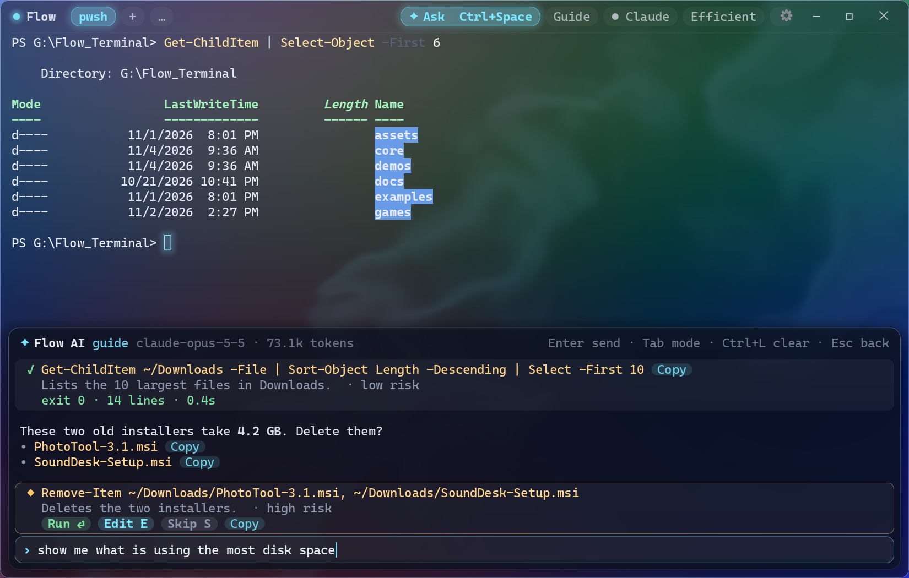

## Quick start

**TL;DR:** install it, open it, and use it as your terminal. Everything else
is there when you want it.

1. **Install.**
   - **macOS** (Apple silicon, macOS 11 or later): open the `.dmg` and drag
     Flow to Applications.
   - **Windows** (10 or 11, x64): run `Flow-<version>-setup.exe`. Windows
     may say it protected your PC: choose **More info → Run anyway**.
   - **Linux** (x86-64, glibc 2.31 or newer): `sudo apt install
     ./Flow-<version>-linux-amd64.deb`, or unpack the tarball and run its
     `install.sh`, which needs no root.

   Each installed Flow updates itself. [Download](#download) has the details.
2. **Open a tab.** Flow starts in your usual shell. **⌘T** (**Ctrl+Shift+T**)
   opens another, and the **…** beside **+** picks its shell and theme.
   **⌘D** (**Ctrl+Shift+D**) splits the tab in two.
3. **Make it yours.** **⌘,** (**Ctrl+,**) opens Settings: the liquid style, an
   old machine's theme, the font, the colors and the CRT. Changes show as you
   make them.
4. **Ask the assistant** (optional). In **Settings → Assistant**, pick Claude,
   GPT or Gemini and add that provider's API key. Then press **⌃Space**
   (**Ctrl+Space**) and ask, say, *"show me what's using the most disk
   space"*.
5. **Get the apps.** In any Flow tab, `flowapp install flow-rogue` installs a
   game, and `flowapp search` lists the rest. See [Apps](#apps-with-flowapp).
6. **Lost?** **⇧⌘P** (**Ctrl+Shift+P**) opens the command palette, which finds
   every command, setting and theme by typing. **F1** shows help for the screen
   in front, and `flow-help` prints it in a tab.

| | macOS | Windows and Linux |
| --- | --- | --- |
| Settings | `⌘,` | `Ctrl+,` |
| The assistant | `⌃Space` | `Ctrl+Space` |
| New tab, close tab | `⌘T`, `⌘W` | `Ctrl+Shift+T`, `Ctrl+Shift+W` |
| Split side by side, one above the other | `⌘D`, `⇧⌘D` | `Ctrl+Shift+D`, `Ctrl+Shift+Alt+D` |
| Command palette | `⇧⌘P` | `Ctrl+Shift+P` |
| Find in the scrollback | `⌘F` | `Ctrl+Shift+F` |
| Command history | `⌘R` | `Ctrl+Shift+R` |
| Record the terminal | `⇧⌘R` | `Ctrl+Shift+Alt+R` (Linux: `Ctrl+Shift+Alt+V`) |
| Help | `F1`, `⌘?` | `F1`, `Ctrl+Shift+?` |

## Apps with `flowapp`

`flowapp` comes with Flow, on the path of every Flow tab, and installs Flow's
apps the way Homebrew installs formulae. Flow itself carries none of them, so
you take only what you want:

| App | What it is |
| --- | --- |
| `flow-rogue` | **Flow Rogue**, a roguelike with a town, the wilds, lairs and a dungeon to go down, drawn in animated sprites |
| `flow-mines` | **Flow Mines**, the mine-finding puzzle, drawn over Flow's liquid |
| `flow-invaders` | **Flow Invaders**, ships coming down in waves in 3D, fought from a truck with a shop between the waves |
| `flow-utils` | **Flow-Utils**, `ls`, `tree`, `man`, `top`, `btop`, `du`, `df` and more written again for Flow, with pictures, bars and graphs in its tabs |
| `flow-phonebook` | **Flow Phonebook**, `dial` to call a BBS over SSH, its pictures, models and sounds reaching your tab |
| `flow-sdk` | **Flow's SDK** for C and Python, with `flow-demo` and its demos |
| `flow-core-themes` | **Flow's machines** as a package of themes, kept up to date |

```sh
flowapp search              # the apps there are
flowapp install flow-rogue  # install one, then run it: flow-rogue
flowapp list                # what you have, and its versions
flowapp upgrade             # update everything you have
flowapp remove flow-rogue   # take one off (your saves stay)
```

**Settings → Apps** does the same with buttons, and can check for newer
versions for you. Every download is checked against the catalog's size and
checksum and Flow's own signature before anything is put in place.

What `flowapp` installs comes after your system's own commands, so Flow-Utils'
`ls` never replaces the system's unasked. `flowapp first flow-utils` puts its
programs first in Flow's tabs, and `flowapp last flow-utils` puts the system's
back. `flowapp --help` lists everything it does.

<table>
  <tr>
    <td>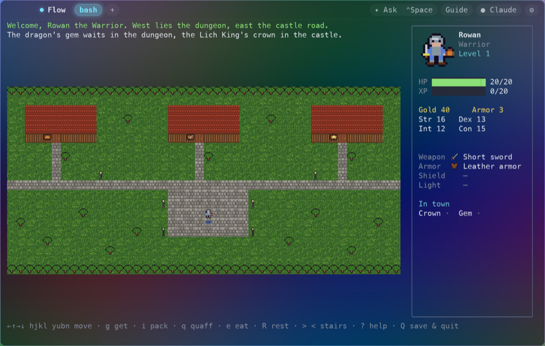</td>
    <td>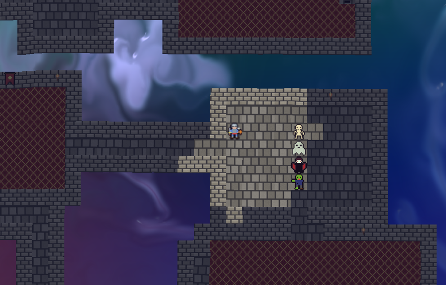</td>
  </tr>
  <tr>
    <td>Flow Rogue's town: the shops, the well, and the roads out</td>
    <td>In the castle, over the <b>Clouds</b> style. The ghost is see-through.</td>
  </tr>
</table>

## What's in it

### The assistant

Say what you want done, and the assistant works in the tab in front. In
**guide** mode it suggests each command for you to run, edit or skip; in
**auto** mode it runs them itself and stops to ask before anything risky: a
high-risk command, overwriting a file, or touching a sensitive one. When a command of yours
fails, **Ask why** offers to explain it. It sees your system, the shell, the
folder and the last 40 lines of the terminal, so mind what's on screen if it
shows secrets. Each provider's key is kept in the macOS Keychain, Windows
Credential Manager, or on Linux the Secret Service, and a token cap in
Settings stops it at a total you choose.

### Tabs, panes and finding your way

<table>
  <tr>
    <td>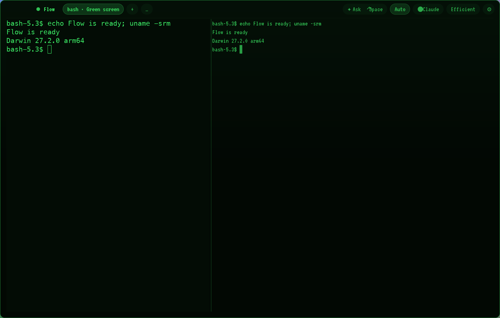</td>
    <td>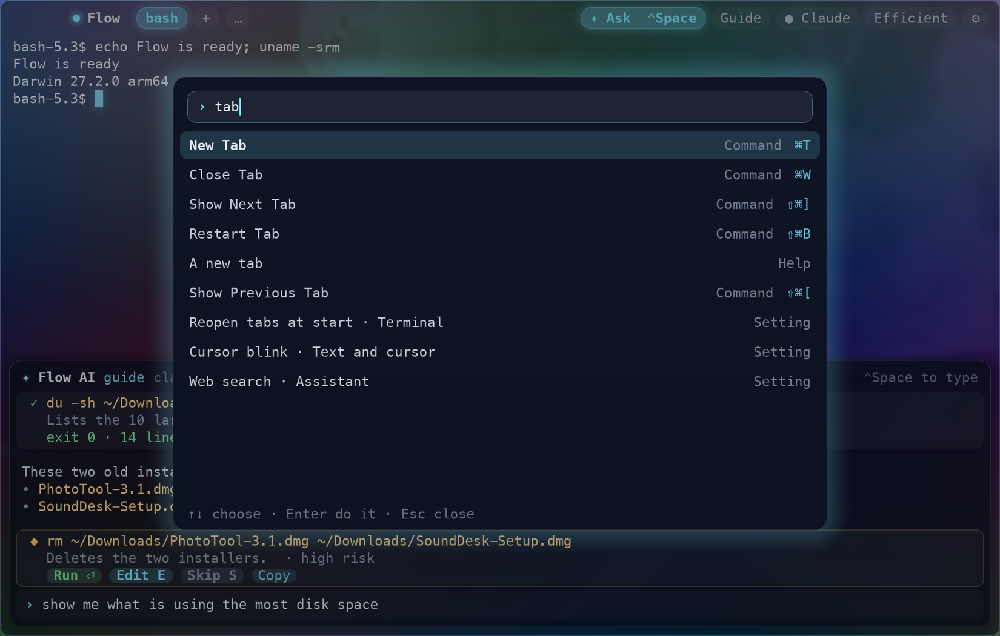</td>
  </tr>
  <tr>
    <td>A split tab, each pane in a theme of its own</td>
    <td>The command palette: every command, setting and theme</td>
  </tr>
  <tr>
    <td>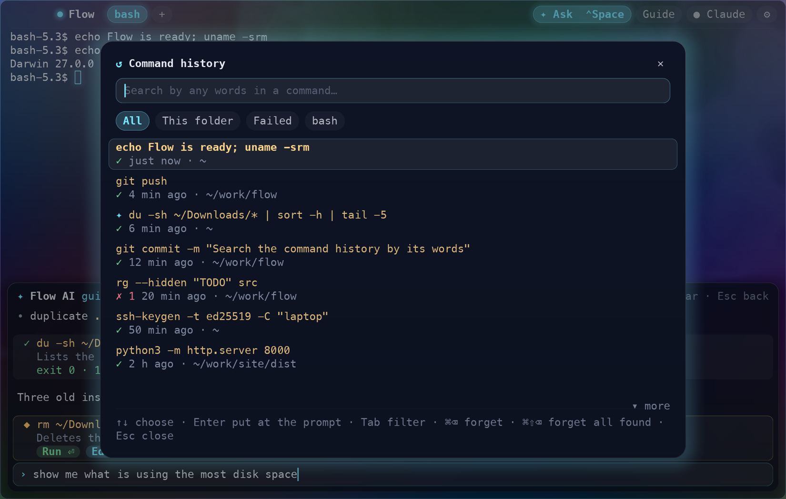</td>
    <td>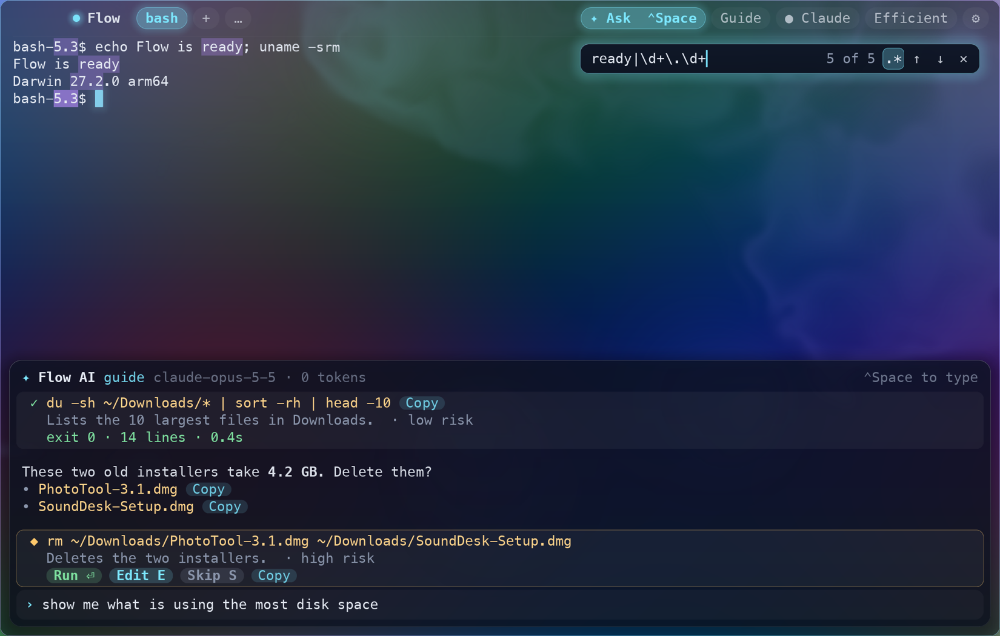</td>
  </tr>
  <tr>
    <td>The command history, found by any words</td>
    <td>Find in the scrollback, words or a pattern</td>
  </tr>
</table>

Each tab runs the shell you pick, in a theme of its own if you like, and
splits into panes that each keep their own. Flow keeps the commands you run,
whatever the shell, with the folder each ran in and how it ended, and finds
them again by any words in them. It reopens your tabs where you left them,
and links that programs write, or plain addresses in the text, open with a
⌘-click (Ctrl+click).

### Pictures and 3D models

<table>
  <tr>
    <td>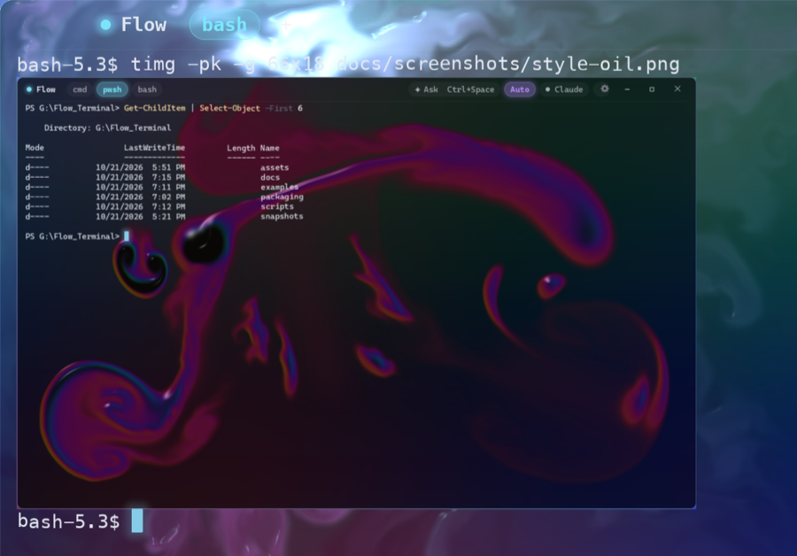</td>
    <td>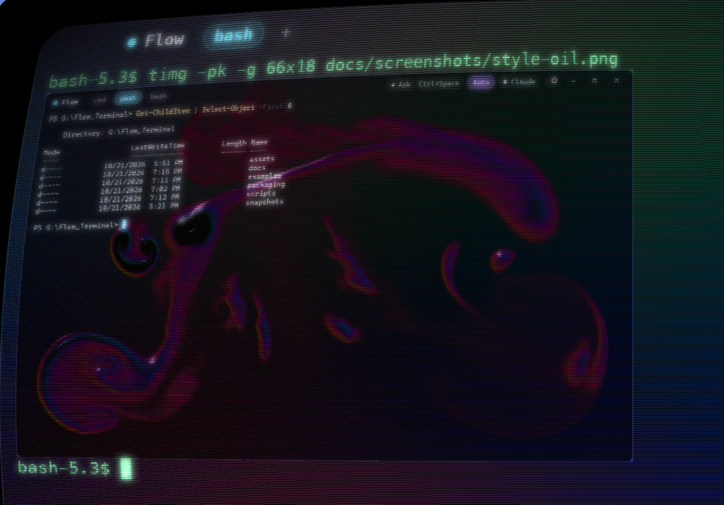</td>
  </tr>
  <tr>
    <td>A picture from <code>timg</code>, over the <b>Clouds</b> style</td>
    <td>The same picture under the <b>CRT</b>: scanlines, curve and glow</td>
  </tr>
</table>

Programs can show pictures in the terminal through the kitty graphics
protocol (`viu`, `timg -pk`, `kitten icat`, yazi), Sixel (`chafa`,
`img2sixel`) and iTerm2's inline images (`imgcat`): PNG, JPEG, GIF, WebP,
BMP and TIFF, and animations play. A picture sits in the terminal like text:
it scrolls, goes into the scrollback and clears, rides the liquid, and glows
under the CRT. On Windows, the console layer between Flow and the shell
drops kitty's escapes, so tools that speak Sixel or iTerm2's protocol show
pictures there, and Flow's own apps send theirs down a pipe Flow opens for
each tab.

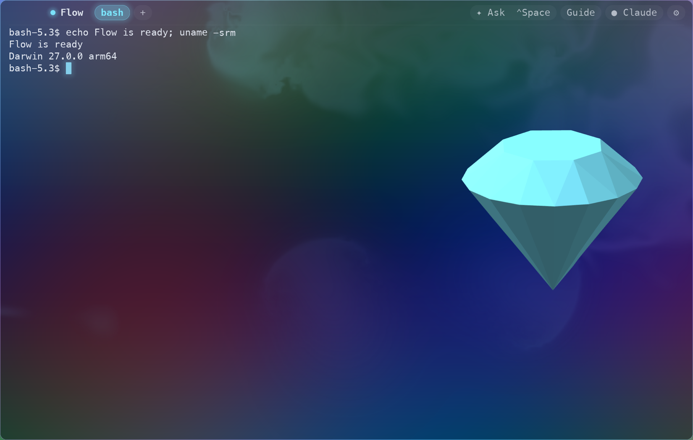

3D models come through the [Ratty graphics
protocol](https://docs.rs/crate/ratty/0.4.1/source/protocols/graphics.md):
OBJ and glTF (`.glb`), lit with their materials and textures, still, turning
or animated, and clickable where a program asks. A model sits in the terminal
as a picture does. If a program asks Flow to read one from a file, Flow asks
you first.

### Themes

<table>
  <tr>
    <td>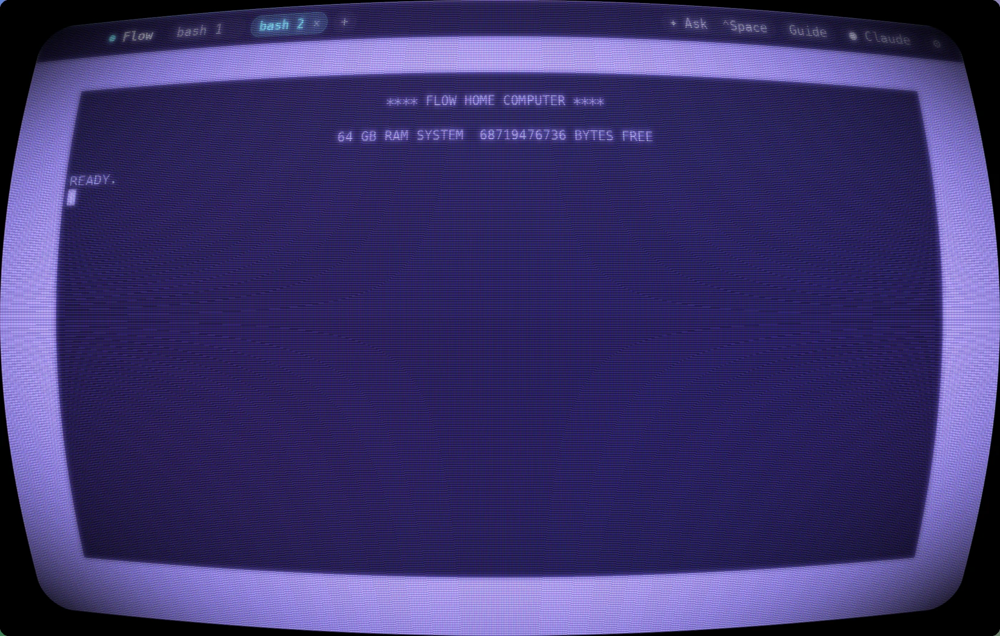</td>
    <td>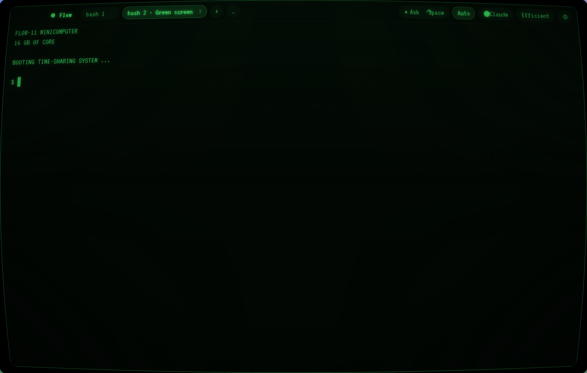</td>
  </tr>
  <tr>
    <td>The <b>Home computer</b></td>
    <td>The <b>Green screen</b>, every color a shade of its phosphor</td>
  </tr>
  <tr>
    <td>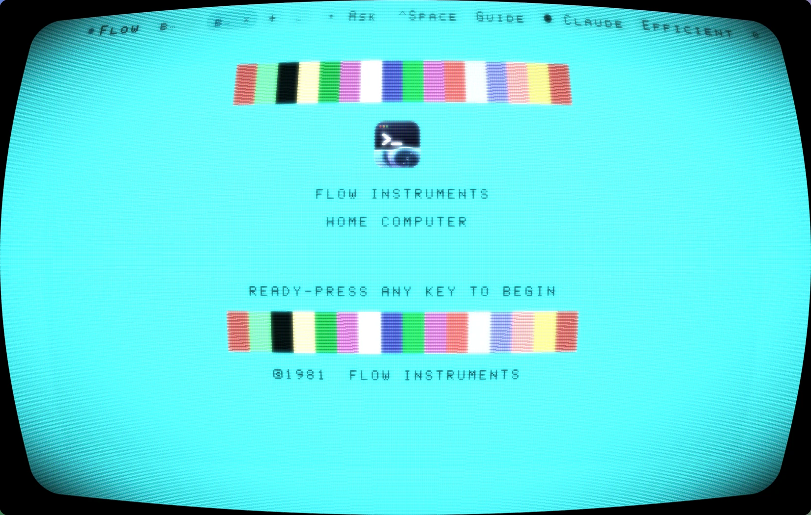</td>
    <td>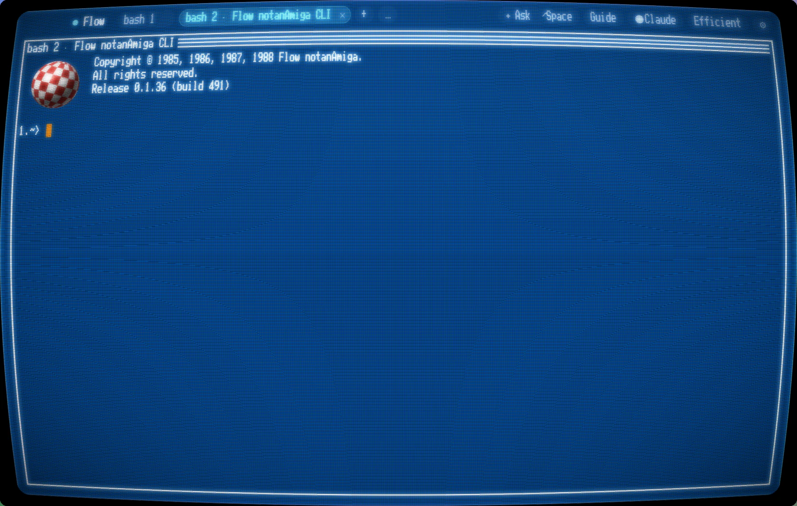</td>
  </tr>
  <tr>
    <td>The <b>Flow Instruments Home Computer</b></td>
    <td>The <b>Flow notanAmiga CLI</b>, framed as its window was</td>
  </tr>
</table>

**Settings → Theme** dresses Flow as an old machine: an 8-bit home computer
on a television, two workstations booting as their PROMs did, a
minicomputer's green screen, an amber screen, a teletype, a British school's
micro in teletext, an eighties PC, an early-eighties home computer and a
16-bit home computer's shell. Each new tab types out the machine's start
screen at the speed of its line and takes its prompt, in the font of its
time, and with **Machines' sounds** on each sounds like itself: a tube's
hum, a teletype's carriage, a disk drive, a fan. The green and amber screens
show everything as a monochrome monitor did, white as the phosphor at full.
**Your own** theme takes a start screen and prompt you type, **Save as
theme…** keeps what you've made under a name, and the **Theme gallery**
previews and installs more.

### Liquid glass

The glass is a live fluid simulation, and your cursor and typing stir it up.
Pick a style in Settings, and slow it down if you like:

<table>
  <tr>
    <td>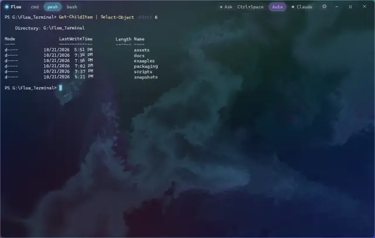</td>
    <td>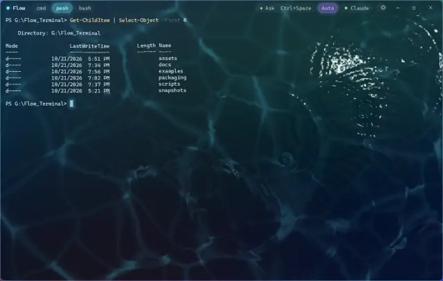</td>
  </tr>
  <tr>
    <td><b>Clouds</b>, with lightning if you like</td>
    <td><b>Water from above</b>: ripples, sunlight and caustics</td>
  </tr>
  <tr>
    <td>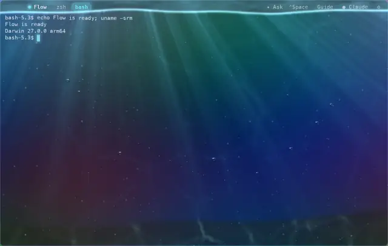</td>
    <td>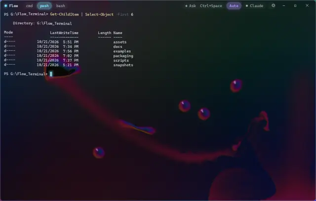</td>
  </tr>
  <tr>
    <td><b>Water from below</b>: light shafts and bubbles</td>
    <td><b>Oil</b>: a glossy, thin-film sheen</td>
  </tr>
  <tr>
    <td>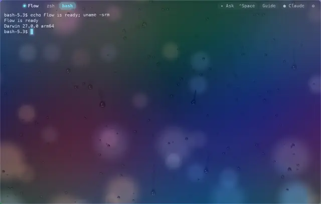</td>
    <td>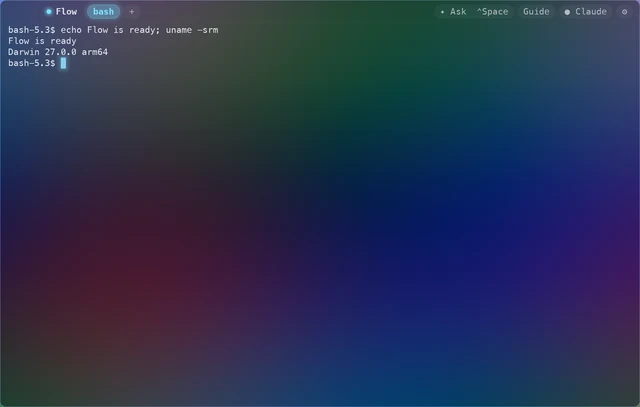</td>
  </tr>
  <tr>
    <td><b>Rain</b> on a fogged window, from a drizzle to a storm, your cursor wiping the glass</td>
    <td><b>None</b>: plain tinted glass</td>
  </tr>
</table>

The glass also shows what the terminal is up to: a ring spreads when a
command finishes (red if it failed), programs that report progress fill it
like a tank, a tab glows when a long command ends behind it, and programs can
set off lightning, splashes and ripples of their own. **Efficient** in the
title bar stills it all to save power, and Flow can do that by itself on
battery.

### CRT

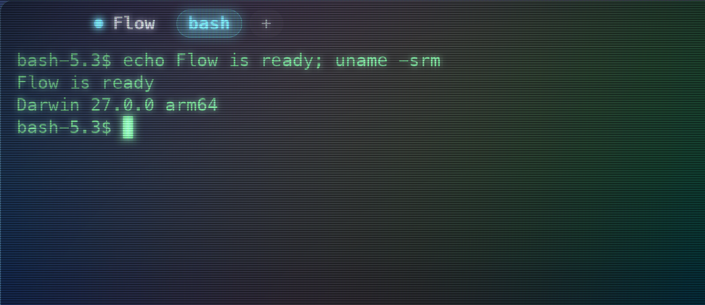

**Settings → CRT** shows everything as an old tube monitor would: scanlines,
interlace, the phosphor's glow and afterglow, the grille, a vignette and the
tube's curve, which clicks and selections follow. Pick a preset (Subtle,
Classic, Arcade, Phosphor or Television) or save your own.

### And more

- **Record the terminal** (**⇧⌘R**) to a looping animated WebP, the liquid
  and the tube in it, to share anywhere that plays one. A countdown comes
  first, and Flow says if your prompt shows your user or computer name.
- **A drop-down terminal:** pick a **Hotkey** in Settings and Flow drops down
  from the top of the screen over whatever you're doing, and away again
  (not on Wayland, which keeps hotkeys to itself).
- **Notifications:** a long command that finishes while you're elsewhere is
  told of by Notification Center, a Windows toast or your Linux desktop.
- **English and Japanese**, Flow's menus, Settings and help alike, with the
  system's input method at the prompt. The assistant answers in your
  language too.
- **Screen readers:** VoiceOver, Narrator and Orca read the terminal,
  Settings and the assistant's panel.
- **For programs:** a program can set off Flow's effects and sounds, change
  its settings (`flow-settings`) and draw pictures and models, from Rust, C
  or Python with [Flow's SDK](https://github.com/arcanii/Flow-SDK).

### More screenshots

<table>
  <tr>
    <td>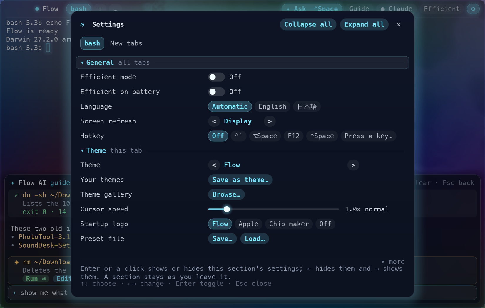</td>
    <td>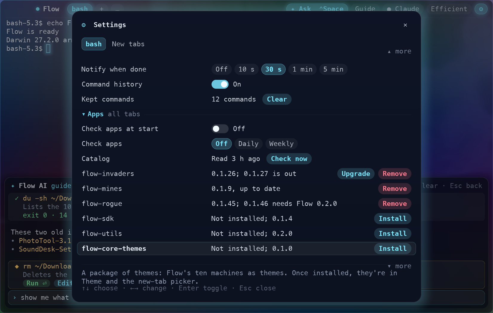</td>
  </tr>
  <tr>
    <td>Settings: the look, the font, the assistant and the rest</td>
    <td><b>Settings → Apps</b>: what <code>flowapp</code> does, with buttons</td>
  </tr>
  <tr>
    <td>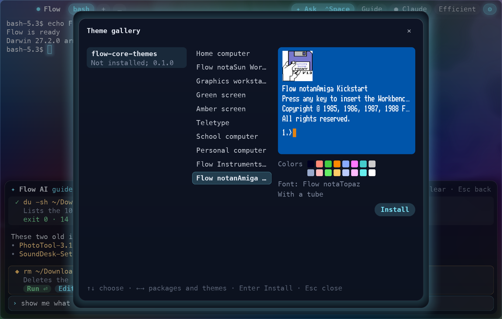</td>
    <td>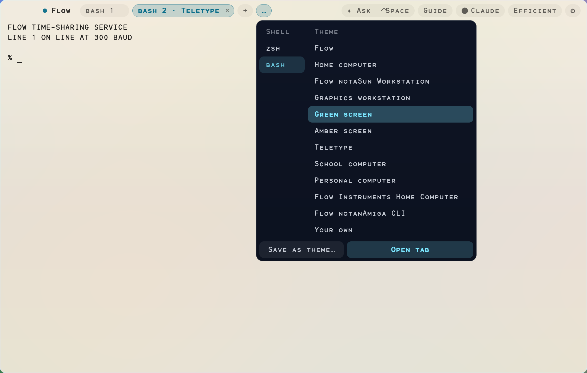</td>
  </tr>
  <tr>
    <td>The <b>Theme gallery</b>, previewing a package of themes</td>
    <td>A new tab: its shell and its theme, side by side</td>
  </tr>
  <tr>
    <td>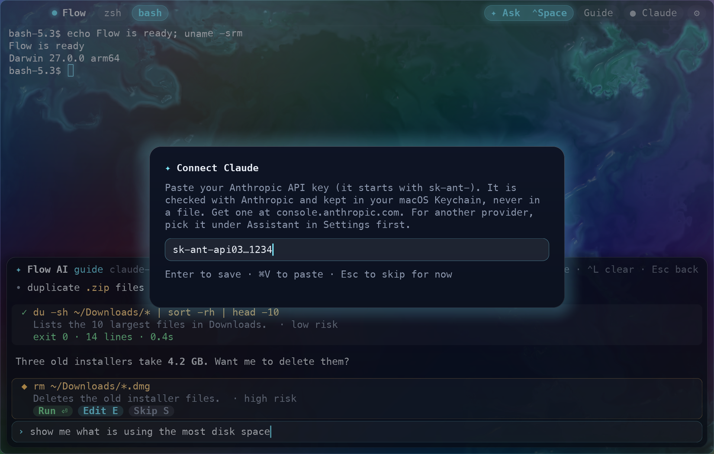</td>
    <td>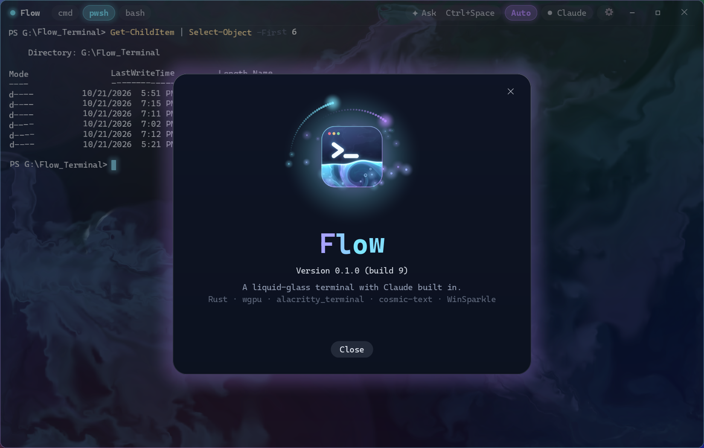</td>
  </tr>
  <tr>
    <td>Adding the assistant's API key</td>
    <td>About, with a check for updates</td>
  </tr>
</table>

## Download

### macOS

Get **Flow-&lt;version&gt;-macos.dmg** from the
[macOS release](https://github.com/arcanii/Flow-releases/releases/tag/v0.1.39-macos),
open it, and drag Flow to Applications. It runs on Macs with Apple silicon and
macOS 11 or later.

- Flow for macOS is signed and notarized, so it opens without a warning.
- It updates itself. Flow asks once whether to check automatically, and
  **Flow → Check for Updates…** checks on demand.
- `SHA256SUMS-macos.txt` in each macOS release lists the checksum.

### Windows

Get **Flow-&lt;version&gt;-setup.exe** from the
[latest release](https://github.com/arcanii/Flow-releases/releases/latest) and
run it. It runs on Windows 10 and 11, x64 (and on Arm through Windows' x64
emulation).

- The installer isn't code-signed yet, so SmartScreen may say "Windows
  protected your PC". Choose **More info → Run anyway**.
- Installed copies update themselves. Flow asks once whether to check
  automatically, and **About → Check for Updates…** checks on demand.
- Prefer not to install? Use the portable zip. Portable copies don't update
  themselves.
- `SHA256SUMS.txt` in each release lists the files' checksums.

### Linux

From the [Linux release](https://github.com/arcanii/Flow-releases/releases/tag/v0.1.39-linux),
for x86-64 Linux with glibc 2.31 or newer (Ubuntu 20.04, Debian 11 and
everything since), on Wayland or X11, with a Vulkan driver:

- **Ubuntu, Debian and others with apt:** get
  **Flow-&lt;version&gt;-linux-amd64.deb** and run
  `sudo apt install ./Flow-<version>-linux-amd64.deb`. `sudo apt remove
  flow-terminal` takes it away. Flow updates itself through apt: **About →
  Install Update** downloads and checks the new .deb, then runs apt in a tab
  of its own, where you type your password, and offers to restart.
- **Any Linux, no root needed:** get **Flow-&lt;version&gt;-linux-x86_64.tar.gz**,
  unpack it and run `./flow-<version>/install.sh`, which puts Flow in
  `~/.local` and in your applications (`--uninstall` takes it away). Installed
  this way, Flow installs its own updates.
- Flow asks once whether to check for updates daily, and **About → Check for
  Updates…** checks on demand.
- Each file's `.sha256` beside it has its checksum.

Every update Flow installs, on every system, carries an Ed25519 signature
that Flow checks before using it, and it refuses any that doesn't verify.

## What this repo holds

- The [releases](https://github.com/arcanii/Flow-releases/releases): Flow's
  Windows installers and portable zips (with the source of the BusyBox they
  bundle, free software under the GPL, version 2), its macOS disk images in
  the releases tagged `-macos`, and its Linux tarballs and .debs in those
  tagged `-linux`; and each app's downloads, in releases tagged
  `<app>-v<version>`.
- `appcast.xml`, `appcast-macos.xml` and `appcast-linux-x86_64.xml`, the
  update feeds that installed copies of Flow read on Windows, macOS and
  Linux, and `apps.json`, the catalog `flowapp` reads.

Something not right? Please [open an
issue](https://github.com/arcanii/Flow-releases/issues).

Flow's source code isn't public yet, but I do plan to make it open source when
it's more mature.

<sub>Intel, AMD, Sun Microsystems and its emblem, SGI and its cube, Amiga and
its Boing Ball (with Kickstart, Workbench and Topaz), Apple and Windows are
trademarks of their respective owners. Flow shows their logos only as a
historical showcase of the computers of their time, and is not related to
them or endorsed by them. Ultima V is a trademark of Electronic Arts; Flow
Rogue carries none of its tiles.</sub>
